# Spectre Lens for core 0.4

Browser observation and actions for Elixir agents. A Stack owns browser
resources, an Agent recognizes routes and a Server coordinates portable tab
references, observations and governed actions. Standalone `SpectreLens` browser,
session, discovery and export APIs remain available without Spectre.

[Documentation index](docs/INDEX.md) · [Migrate from core 0.3](docs/MIGRATING_TO_SPECTRE_0_4.md)



[Diagram source](docs/assets/readme-architecture.mmd).

Bind both `open` and `look` when browsing requires consent. Without those
bindings they use the cognitive path; `close` releases a known tab.

## Installation on this development branch

Use these matching branches while core 0.4 is unreleased. Pin reviewed commit
refs for deployment; satellite package versions are independent of core.

```elixir
defp deps do
  [
    {:spectre, github: "elchemista/spectre",
     branch: "feature/agent-server-gam", override: true},
    {:spectre_lens, github: "elchemista/spectre_lens",
     branch: "feature/stack-tools-0.4"}
  ]
end
```

For sibling checkouts, replace these with `path: "../spectre"` and
`path: "../spectre_lens"` dependencies. Package integration tests use
`SPECTRE_PATH=../spectre mix test`.

Provision a supported browser separately; starting a runtime never downloads one.
For the bundled Lightpanda backend, use `mix spectre.lens.install` and
`mix spectre.lens.doctor`, or configure an existing binary. Other backends can
implement `SpectreLens.Browser` and `SpectreLens.Protocol`. See the
[standalone browser guide](docs/STANDALONE.md).

## Observe a page through the Server

```elixir
defmodule MyApp.WebAI do
  use Spectre.Stack
  install Spectre.Lens do
    backend(SpectreLens.Browsers.Lightpanda, instances: 1)
  end
end

defmodule MyApp.WebServer do
  use Spectre.Server, tools: MyApp.WebAI

  def handle_flow({:web, :open}, input, ctx),
    do: lens(ctx, {:open, input.text}, on_result: :opened)

  def handle_result(:opened, {:ok, tab}, ctx),
    do: ctx |> assign(:tab, tab) |> lens({:look, tab}, on_result: :looked)

  def handle_result(:looked, {:ok, view}, ctx),
    do: ctx |> assign(:page, view) |> lens({:close, ctx.assigns.tab}, on_result: :closed)

  def handle_result(:closed, {:ok, _}, ctx),
    do: respond(ctx, ctx.assigns.page.context)

  def handle_result(tag, result, ctx), do: super(tag, result, ctx)
end

defmodule MyApp.WebAgent do
  use Spectre.Agent, stack: MyApp.WebAI, server: MyApp.WebServer
  flow :web do
    on(:open, regex: ~r/^https:\/\//)
  end
end
```

`lens/3` is generated by `use Spectre.Server, tools:` from the installed
`tools/1` descriptor. No `import Spectre.Lens, only: [lens: 3]` exists.

```elixir
children = [
  {Spectre.Stack.Runtime,
   stack: MyApp.WebAI, name: MyApp.WebRuntime,
   packages: [lens: [binary: "/opt/lightpanda"]]}
]
```

After supervising the Stack runtime, start the Server:

```elixir
{:ok, server} = Spectre.Server.start_link(
  agent: MyApp.WebAgent, stack_runtime: MyApp.WebRuntime, consumer: self())
{:ok, interaction} = Spectre.Server.input(server, "https://example.com")
```

Runtime processes and credentials remain outside durable arguments. The worker
resolves them through the named Stack runtime.

## Browser operations and recovery

| Helper input | Result | Boundary |
| --- | --- | --- |
| `{:open, url}` | `{:ok, tab_map}` | Cognitive; nonrepeatable allocation |
| `{:look, tab_map}` or `{:look, url}` | `{:ok, view_map}` | Cognitive; repeatable observation |
| `{:close, tab_map}` | `{:ok, %{closed: true}}` | Cognitive; nonrepeatable cleanup |
| `{:act, tab_map, action_map}` | Core governed result | Requires an allowed GAM operation |

View data has `trust: :untrusted` and escaped `context`. Page content is data,
not authority or instructions. Live Tabs, CDP connections and PIDs never enter
the checkpoint. For browser effects, install with
`bind: [act: :browser_action]`, configure
`gam: [operations: %{browser_action: [confirm: true]}]` and call
`lens(ctx, {:act, tab, %{"type" => "click", "ref" => "#save"}}, on_result: :acted)`.
Spectre invokes Lens' registered effect adapter only after GAM commits the Act.
All supported browser action types use that governed path.

For consent before browsing, bind **both** `open` and `look` to GAM operations:
`look(url)` can navigate too. See [consent-controlled navigation](docs/MIGRATING_TO_SPECTRE_0_4.md#require-gam-consent-for-navigation).
Without these bindings, `open` and `look` retain their cognitive behavior.

Opening or closing may finish even if its acknowledgement is lost. The Server
returns `{:tool_unknown, details}` after an uncertain nonrepeatable call; do not
reissue it automatically. Explicitly close known tabs and configure host/browser
cleanup for abandoned resources. The URL policy defaults to public destinations;
trusted runtime configuration owns network access, never model action arguments.


## Further reading

- [Standalone APIs, browser backends, sessions and exports](docs/STANDALONE.md)
- [Migration, schemas and host execution](docs/MIGRATING_TO_SPECTRE_0_4.md)
- [Public API contract](docs/PUBLIC_API.md)
- [Historical Instance/Action-provider integration](docs/LEGACY_0_3.md)

## Runtime and examples

The generated `lens` helper also works in [Skill Server callbacks](https://github.com/elchemista/spectre/blob/feature/agent-server-gam/docs/SKILLS.md).
Skills share the root's GAM Domain; enable governed operations on the root and
allow them in the mount's `governed:` references. The
[core tool guide](https://github.com/elchemista/spectre/blob/feature/agent-server-gam/docs/STACK_TOOLS.md) covers scheduling and recovery;
[Managed GAM](https://github.com/elchemista/spectre/blob/feature/agent-server-gam/docs/MANAGED_GAM.md) covers consent and registered execution.

See the [LiveView demo](https://github.com/elchemista/demo_spectre) for an application,
the [Spectre guides](https://spectre.guide) for articles, and the
[release audit](https://github.com/elchemista/spectre/blob/feature/agent-server-gam/docs/RELEASE_0_4.md) for verified revisions.
